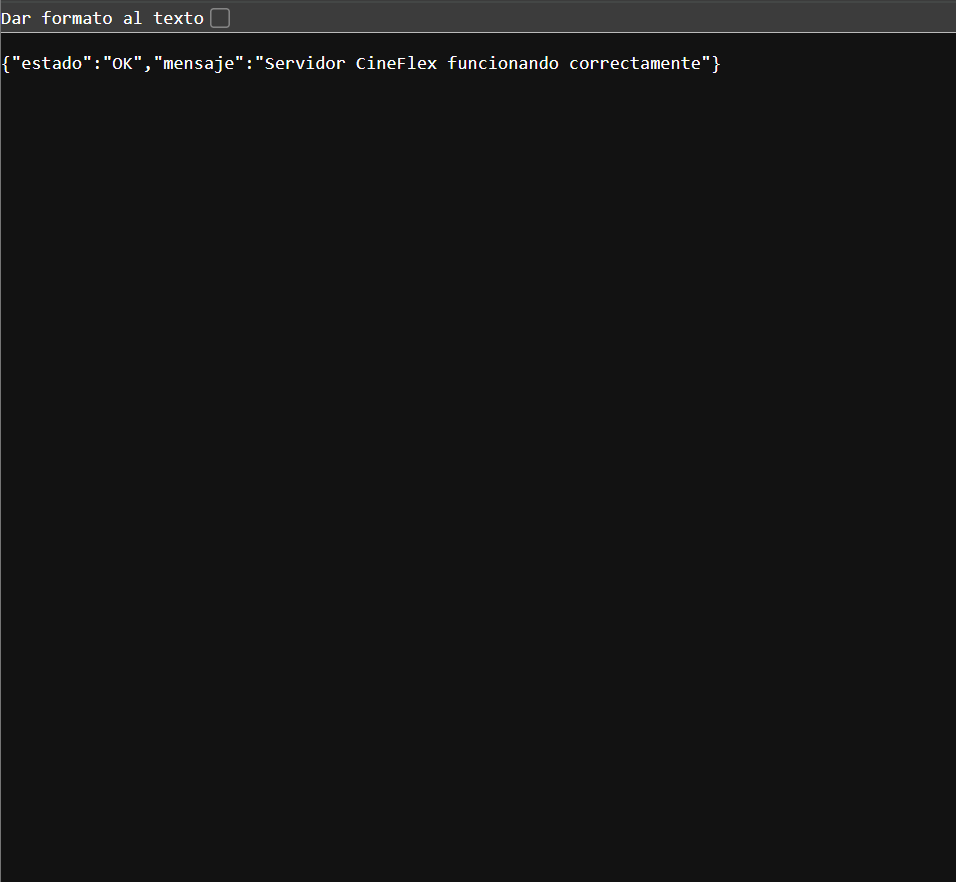

# CineFlex | Aseguramiento de Calidad y Pruebas Automatizadas

**Proyecto:** Taller Práctico Integrador — QA en Producción

**Integrantes:** Luis, Marlon y Esteban

**Repositorio:** https://github.com/pollofrito18/qa-cineflex-project

**Video de sustentación (máximo 3 minutos):** Pendiente de agregar el enlace público.

---

## 1. Introducción

CineFlex es una plataforma web simulada para la reserva y compra de entradas de cine.

Este proyecto fue desarrollado con el objetivo de aplicar estrategias de aseguramiento de calidad (QA), automatizar pruebas y verificar el funcionamiento de los principales componentes de una aplicación web.

El sistema permite:

- Iniciar sesión mediante autenticación JWT.
- Consultar las películas disponibles.
- Seleccionar películas y horarios.
- Visualizar y seleccionar asientos disponibles.
- Simular pagos aprobados y rechazados.
- Generar tickets virtuales.
- Consultar la información de una reserva.

Se utilizaron herramientas de pruebas como Postman, Newman, Selenium WebDriver, Apache JMeter y GitHub Actions.

**Nota:** CineFlex es un entorno académico simulado. No realiza pagos bancarios reales ni utiliza una base de datos persistente.

---

## 2. Objetivos

### Objetivo general

Aplicar técnicas de aseguramiento de calidad para validar las funcionalidades, el rendimiento y la automatización de pruebas de CineFlex.

### Objetivos específicos

1. Desarrollar una API REST funcional con Node.js y Express.
2. Implementar autenticación mediante JWT.
3. Simular las respuestas de una pasarela bancaria.
4. Automatizar pruebas de API con Postman y Newman.
5. Automatizar pruebas de interfaz utilizando Selenium y Page Object Model.
6. Evaluar el comportamiento del sistema mediante Apache JMeter.
7. Implementar integración continua con GitHub Actions.
8. Documentar las pruebas y sus resultados.

---

## 3. Arquitectura del sistema

CineFlex está organizado en los siguientes componentes:

| Componente | Tecnología | Responsabilidad |
|---|---|---|
| Frontend | HTML, CSS y JavaScript | Interfaz de usuario |
| Backend | Node.js y Express | API REST y lógica de reservas |
| Seguridad | JWT, Helmet y bcryptjs | Autenticación y protección |
| Registro HTTP | Morgan | Trazabilidad de solicitudes |
| API Testing | Postman | Pruebas de endpoints |
| Automatización API | Newman | Ejecución de colecciones |
| UI Testing | Selenium WebDriver | Pruebas del navegador |
| Organización UI | Page Object Model | Separación de acciones y verificaciones |
| Rendimiento | Apache JMeter | Simulación de carga |
| Integración continua | GitHub Actions | Pruebas automáticas al subir cambios |

### Funcionamiento general

1. El usuario accede a la aplicación web.
2. El Frontend envía las solicitudes al Backend.
3. El Backend verifica las credenciales y genera un token JWT.
4. El usuario consulta la cartelera y selecciona una película.
5. El Backend informa la disponibilidad de asientos.
6. El usuario selecciona un asiento y un método de pago simulado.
7. El sistema acepta o rechaza la operación.
8. Si el pago es aprobado, se genera un ticket virtual.

---

## 4. Estructura del proyecto

```text
qa-cineflex-project/
│
├── README.md
├── estrategia_pruebas.pdf
├── .gitignore
│
├── backend/
│   ├── server.js
│   ├── package.json
│   └── package-lock.json
│
├── frontend/
│   ├── index.html
│   ├── styles.css
│   └── app.js
│
├── api_tests/
│   ├── CineFlex_API_Collection.json
│   └── CineFlex_Environment.json
│
├── ui_tests/
│   ├── pages/
│   │   ├── LoginPage.js
│   │   ├── CarteleraPage.js
│   │   └── ReservaPage.js
│   ├── test_suite.js
│   ├── package.json
│   └── package-lock.json
│
├── performance/
│   └── prueba_carga.jmx
│
├── evidencias/
│   └── Evidencias_CineFlex_Recuperadas/
│
└── .github/
    └── workflows/
        └── qa-pipeline.yml
```

---

## 5. Instalación y configuración

### 5.1. Requisitos

Para ejecutar el proyecto se recomienda tener instalados:

- Node.js y npm.
- Git.
- Visual Studio Code.
- Google Chrome.
- Postman.
- Java y Apache JMeter para las pruebas de rendimiento.

### 5.2. Clonar el repositorio

Abrir PowerShell o la terminal de VS Code:

```powershell
git clone https://github.com/pollofrito18/qa-cineflex-project.git
cd qa-cineflex-project
```

### 5.3. Instalar dependencias

Ingresar a la carpeta del Backend:

```powershell
cd backend
npm ci
```

### 5.4. Configurar variables de entorno

Crear un archivo llamado `.env` dentro de `backend`.

Contenido:

```env
PORT=3000
JWT_SECRET=GENERAR_UNA_CLAVE_ALEATORIA_SEGURA
```

Para generar una clave segura desde PowerShell:

```powershell
node -e "console.log(require('crypto').randomBytes(32).toString('hex'))"
```

Sustituir el valor de `JWT_SECRET` por la clave generada.

El archivo `.env` está excluido mediante `.gitignore` y no debe publicarse.

### 5.5. Ejecutar el Backend

Desde la carpeta `backend`:

```powershell
npm start
```

La aplicación estará disponible en:

http://localhost:3000/

Para verificar el funcionamiento del servidor:

http://localhost:3000/api/health

Se espera una respuesta con el estado `OK`.

### 5.6. Cuenta de demostración

**Correo:** `cliente@cineflex.com`

**Contraseña:** `CineFlex123!`

Estas credenciales pertenecen únicamente a un usuario ficticio del entorno académico.

---

## 6. Fase A — Arquitectura y estrategia de pruebas

### 6.1. Reto 1: Integración Top-Down y Stub bancario

El primer reto consiste en comprobar el proceso de compra cuando todavía no existe acceso a la API de una pasarela bancaria real.

Se seleccionó la estrategia de integración **Top-Down**, porque permite validar las funcionalidades principales y sustituir temporalmente los servicios que aún no están disponibles.

Para resolver este problema se implementó un **Stub bancario**, encargado de simular las respuestas de una entidad financiera.

La simulación se encuentra implementada en `backend/server.js`.

Se definieron dos escenarios:

| Valor de prueba | Respuesta | Resultado |
|---|---|---|
| `PRUEBA_APROBADA` | Pago aprobado | Genera ticket virtual |
| `TARJETA_FALSA` | HTTP 402 | Rechaza la operación |

De esta forma se verifica que CineFlex interprete correctamente las respuestas bancarias y gestione las reservas sin realizar transacciones reales.

### 6.2. Reto 2: Requisitos y estrategia de regresión

#### Requisitos funcionales

**RF-01: Autenticación de usuario**

El sistema debe permitir que un usuario registrado inicie sesión con credenciales válidas.

**RF-02: Reserva de entradas**

El sistema debe permitir seleccionar un asiento disponible, procesar un pago simulado aprobado y generar un ticket virtual.

#### Requisitos no funcionales

**RNF-01: Tiempo de respuesta**

La consulta de cartelera debe responder en menos de 300 milisegundos en el entorno de pruebas establecido.

**RNF-02: Evaluación de rendimiento**

El sistema debe someterse a una prueba de carga con 500 usuarios virtuales y un periodo de arranque gradual de 15 segundos.

#### Estrategia de regresión

Las pruebas de regresión permiten comprobar que los cambios realizados en el sistema no afecten funcionalidades existentes.

La selección de pruebas depende del impacto de cada modificación.

Por ejemplo, si un desarrollador modifica únicamente el color de un botón secundario, se deben priorizar verificaciones visuales y de funcionamiento del elemento.

No es necesario ejecutar nuevamente todas las pruebas bancarias si el cambio no afecta dicho módulo.

Sin embargo, si se modifica la autenticación, el proceso de reserva o la lógica de pagos, deben repetirse las pruebas correspondientes y los flujos críticos relacionados.

Esto permite optimizar el tiempo de ejecución y los recursos utilizados.

### 6.3. Reto 3: Selenium WebDriver frente a Cypress

Se realizó una comparación técnica para seleccionar la herramienta apropiada para CineFlex.

| Criterio | Selenium WebDriver | Cypress |
|---|---|---|
| Propósito | Automatización de navegadores | Pruebas y depuración web |
| Navegadores | Amplio soporte mediante WebDriver | Navegadores compatibles con Cypress |
| Lenguajes | Compatible con varios lenguajes | Principalmente JavaScript y TypeScript |
| Ejecución | Control mediante WebDriver | Ejecución integrada con herramientas de pruebas web |
| Depuración | Uso de registros y herramientas externas | Herramientas integradas para inspección |
| Aplicación en CineFlex | Flujo completo de reserva | Pruebas rápidas del Frontend |

**Herramienta seleccionada: Selenium WebDriver.**

Se eligió Selenium para automatizar los principales flujos de usuario y estructurar el código mediante el patrón Page Object Model.

Cypress sería una alternativa apropiada para pruebas frecuentes de componentes del Frontend durante el desarrollo.

El análisis completo se encuentra en el documento:

[estrategia_pruebas.pdf](estrategia_pruebas.pdf)

---

## 7. Fase B — Pruebas de API con Postman

Se desarrolló una colección de pruebas automatizadas para tres endpoints principales.

### 7.1. Endpoints evaluados

| Método | Endpoint | Validación |
|---|---|---|
| POST | `/api/auth/login` | Inicio de sesión y JWT |
| GET | `/api/cartelera` | Consulta de películas y rendimiento |
| POST | `/api/reservas` | Rechazo de tarjeta falsa |

### 7.2. Inicio de sesión

La solicitud `POST /api/auth/login` verifica:

- Respuesta HTTP 200.
- Autenticación correcta.
- Existencia de un token JWT.
- Captura automática del token para otras solicitudes.

### 7.3. Consulta de cartelera

La solicitud `GET /api/cartelera` verifica:

- Autorización con el token JWT.
- Código HTTP 200.
- Respuesta JSON válida.
- Existencia de películas.
- Tiempo de respuesta inferior a 300 milisegundos.

### 7.4. Pago rechazado

La solicitud `POST /api/reservas` utiliza el método de pago `TARJETA_FALSA`.

Se comprueba que:

- El Backend rechace la transacción.
- Se devuelva HTTP 402.
- El mensaje de error sea el esperado.
- No se confirme una reserva mediante un pago rechazado.

### 7.5. Resultados de Postman

**Resultados obtenidos:**

- Peticiones ejecutadas: 3.
- Aserciones aprobadas: 16.
- Aserciones fallidas: 0.


---

## 8. Automatización de API mediante Newman

Newman permite ejecutar las colecciones de Postman directamente desde la terminal.

Con el Backend encendido, ingresar a `backend` y ejecutar:

```powershell
npx newman run ..\api_tests\CineFlex_API_Collection.json -e ..\api_tests\CineFlex_Environment.json
```

### Resultados comprobados

| Métrica | Resultado |
|---|---|
| Solicitudes | 3 |
| Aserciones | 16 |
| Aprobadas | 16 |
| Fallidas | 0 |

Esta ejecución permite comprobar automáticamente los comportamientos esperados de la API.

---

## 9. Fase C — Pruebas de interfaz con Selenium

Se utilizó Selenium WebDriver para automatizar las acciones del usuario dentro de Google Chrome.

La suite se organizó mediante el patrón **Page Object Model (POM)**.

### 9.1. Organización de POM

**LoginPage.js**

Contiene los localizadores y las acciones relacionadas con el inicio y cierre de sesión.

**CarteleraPage.js**

Gestiona las interacciones relacionadas con la cartelera y la selección de películas.

**ReservaPage.js**

Contiene las acciones necesarias para seleccionar horarios, asientos, métodos de pago y consultar tickets.

**test_suite.js**

Contiene los casos de prueba y sus aserciones.

Esta separación facilita el mantenimiento y la reutilización del código.

### 9.2. Casos de prueba implementados

| Nº | Caso de prueba |
|---|---|
| 1 | Inicio de sesión exitoso |
| 2 | Cartelera con tres películas |
| 3 | Visualización de títulos de películas |
| 4 | Selección de película y apertura de reserva |
| 5 | Regreso desde reserva a cartelera |
| 6 | Validación de horarios de película 1 |
| 7 | Validación de horarios de película 2 |
| 8 | Verificación de doce asientos |
| 9 | Restricción de asiento ocupado |
| 10 | Restricción de continuación sin seleccionar asiento |
| 11 | Actualización de asiento seleccionado |
| 12 | Resumen correcto del pago |
| 13 | Rechazo de tarjeta falsa |
| 14 | Pago aprobado y generación del ticket |
| 15 | Actualización del resumen al cambiar horario |
| 16 | Validación del título Cartelera en el DOM |
| 17 | Cierre de sesión y protección con botón Atrás |
| 18 | Bloqueo después de tres intentos fallidos |

### 9.3. Ejecutar Selenium

Con el servidor encendido, abrir otra terminal:

```powershell
cd ui_tests
npm ci
npm test
```

### 9.4. Resultados finales de Selenium

En la ejecución final se obtuvieron:

| Métrica | Resultado |
|---|---|
| Pruebas ejecutadas | 18 |
| Pruebas aprobadas | 18 |
| Pruebas fallidas | 0 |
| Pruebas omitidas | 0 |
| Duración | 42,46 segundos |

**Resultado: 100 % de las pruebas ejecutadas aprobaron.**

También se comprobaron los escenarios obligatorios solicitados:

- Bloqueo temporal después de tres contraseñas incorrectas.
- Verificación del título Cartelera dentro del DOM.
- Generación de un ticket tras un pago aprobado.
- Cierre de sesión y protección de navegación mediante Atrás.

### Evidencia final de Selenium


La prueba de bloqueo se ejecuta al final porque bloquea temporalmente la cuenta de demostración durante 60 segundos.

Para volver a ejecutar toda la suite inmediatamente, se puede reiniciar el Backend y restaurar el estado en memoria.

---

## 10. Fase D — Pruebas de rendimiento con Apache JMeter

Se utilizó Apache JMeter para evaluar el comportamiento de CineFlex bajo una carga simulada de usuarios.

El plan de pruebas se encuentra en:

`performance/prueba_carga.jmx`

### 10.1. Configuración del escenario

| Parámetro | Configuración |
|---|---|
| Usuarios virtuales | 500 |
| Ramp-up | 15 segundos |
| Iteraciones | 1 |
| Endpoint | `/api/peliculas/1/asientos` |
| Método HTTP | GET |
| Autenticación | JWT |

Antes de iniciar las consultas de disponibilidad se ejecuta una autenticación para obtener el token JWT.

Los usuarios virtuales se inician gradualmente durante 15 segundos.

### 10.2. Resultados obtenidos

| Métrica | Resultado |
|---|---|
| Solicitudes de autenticación | 1 |
| Consultas de asientos | 500 |
| Solicitudes totales | 501 |
| Errores | 0 % |
| Tiempo promedio aproximado | 3 ms |
| Throughput de consultas de asientos | 33,4 solicitudes/s aproximadamente |

Durante la prueba local, el servidor respondió correctamente a las 500 consultas de asientos.

El resultado no representa una certificación de disponibilidad en un entorno productivo, sino una medición realizada bajo condiciones controladas.

### 10.3. Evidencia del Summary Report


### 10.4. Ejecutar el plan de JMeter

Desde la carpeta principal del proyecto, con el Backend encendido:

```powershell
jmeter -n -t performance/prueba_carga.jmx -l performance/resultados_carga.jtl
```

Este comando requiere que JMeter esté disponible en el PATH del sistema.

Si no lo está, debe utilizarse la ruta completa de `jmeter.bat`.

Antes de repetir una prueba se debe evitar reutilizar un archivo JTL que contenga resultados anteriores.

---

## 11. Integración continua con GitHub Actions

Se implementó un pipeline de integración continua mediante GitHub Actions.

El archivo de configuración se encuentra en:

`.github/workflows/qa-pipeline.yml`

### 11.1. Funcionamiento

El pipeline se ejecuta cuando se realiza un `push` o un `pull_request` hacia la rama `main`.

El flujo realiza las siguientes tareas:

1. Descarga el repositorio.
2. Configura Node.js.
3. Instala las dependencias.
4. Inicia el Backend con variables de entorno temporales.
5. Comprueba el endpoint de salud.
6. Ejecuta la colección de Postman utilizando Newman.
7. Marca la ejecución como fallida si una prueba no pasa.

### 11.2. Resultados comprobados

Se obtuvo una ejecución exitosa de Newman dentro de GitHub Actions:

- Peticiones: 3.
- Aserciones aprobadas: 16.
- Aserciones fallidas: 0.


[Consultar ejecuciones de GitHub Actions](https://github.com/pollofrito18/qa-cineflex-project/actions)

**Alcance del pipeline:** GitHub Actions ejecuta las pruebas de API con Newman. Las pruebas de Selenium y JMeter se ejecutaron por separado.

---

## 12. Evidencias generales

Las capturas de pantalla se encuentran dentro del directorio `evidencias`.

### Servidor funcionando



### Pago rechazado


### Ticket virtual confirmado


### Postman


### Selenium


### JMeter


### GitHub Actions


---

## 13. Seguridad y limitaciones

El proyecto corresponde a un entorno académico de pruebas.

Por esta razón:

- No se utiliza una pasarela de pagos real.
- Las reservas se almacenan temporalmente en memoria.
- El estado de las reservas se reinicia cuando se reinicia el servidor.
- Las credenciales de demostración no deben utilizarse en sistemas reales.
- La clave JWT se configura en variables de entorno privadas.
- Las pruebas de JMeter se ejecutaron en un entorno local.
- Las pruebas exitosas no garantizan la ausencia de vulnerabilidades.
- Algunas dependencias de desarrollo requieren revisión de seguridad antes de cualquier despliegue real.

La aplicación y las pruebas deben adaptarse y fortalecerse antes de utilizarse en un sistema de producción.

---

## 14. Documento de estrategia de pruebas

El documento `estrategia_pruebas.pdf` contiene:

- Justificación de la integración Top-Down.
- Diseño del Stub bancario.
- Requisitos funcionales.
- Requisitos no funcionales.
- Estrategia de regresión.
- Comparación entre Selenium y Cypress.
- Resultados y evidencias del proyecto.

[Consultar estrategia de pruebas](estrategia_pruebas.pdf)

---

## 15. Video de sustentación

**Duración máxima:** 3 minutos.

**Integrantes:** Luis, Marlon y Esteban.

**Enlace al video:** Pendiente de publicar.

### Distribución de la exposición

| Integrante | Responsabilidad |
|---|---|
| Luis | Introducción, requisitos y regresión |
| Marlon | Integración Top-Down y Stub bancario |
| Esteban | Selenium frente a Cypress, pruebas y resultados |

Durante el video se debe mostrar:

- Arquitectura y estructura del proyecto.
- Código del Stub bancario.
- Los tres retos de la Fase A.
- Organización del patrón Page Object Model.
- Ejecución de las pruebas.
- Resultados de JMeter y GitHub Actions.

Antes de la entrega se debe publicar el video en YouTube, Google Drive o una plataforma equivalente con un enlace accesible para el profesor.

El enlace público debe agregarse al comienzo de este README.

---

## 16. Conclusiones

El proyecto CineFlex permitió aplicar diferentes técnicas de aseguramiento de calidad a una aplicación web simulada.

Las pruebas con Postman y Newman comprobaron los principales endpoints de la API.

Selenium WebDriver permitió automatizar 18 escenarios de interfaz, incluyendo autenticación, selección de asientos, pagos, tickets y controles de acceso.

Apache JMeter permitió evaluar un escenario de 500 usuarios virtuales, mientras que GitHub Actions automatizó la ejecución de pruebas de API ante cambios en el repositorio.

Los resultados obtenidos permitieron demostrar el funcionamiento de los componentes evaluados y la importancia de implementar pruebas automatizadas durante el desarrollo de software.

---

**Proyecto académico CineFlex — QA en Producción**

**Integrantes:** Luis, Marlon y Esteban

**Repositorio:** https://github.com/pollofrito18/qa-cineflex-project
