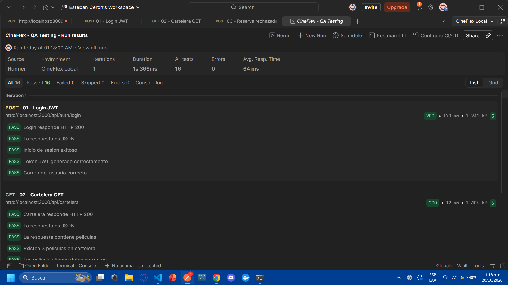
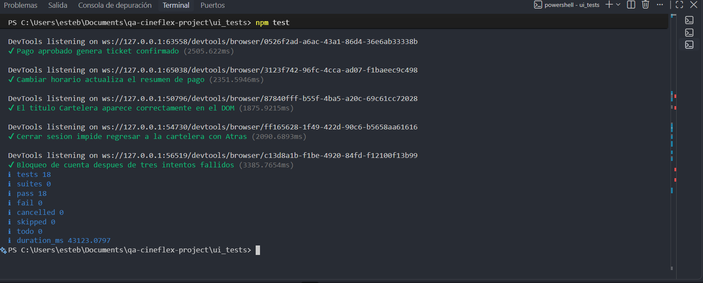
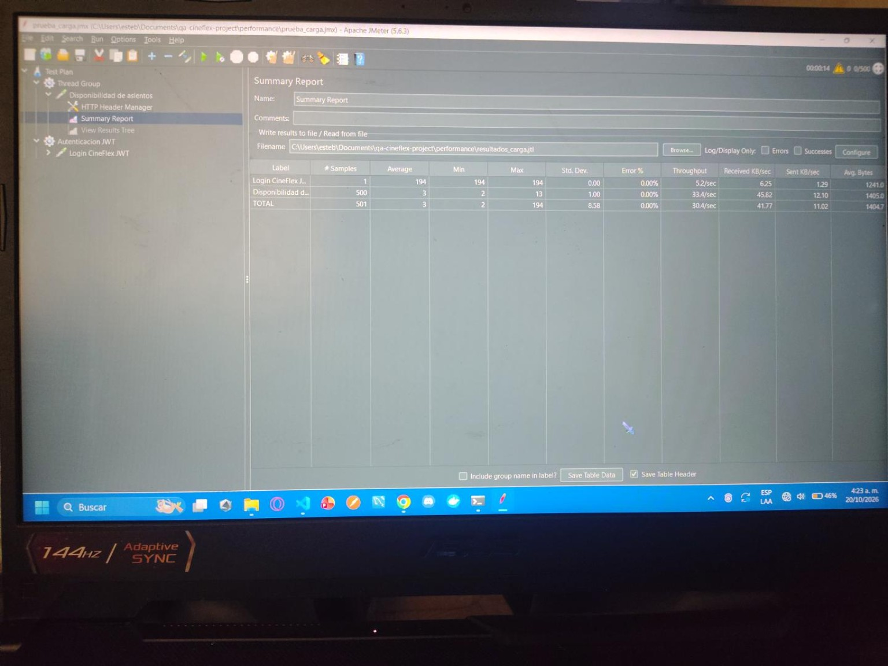
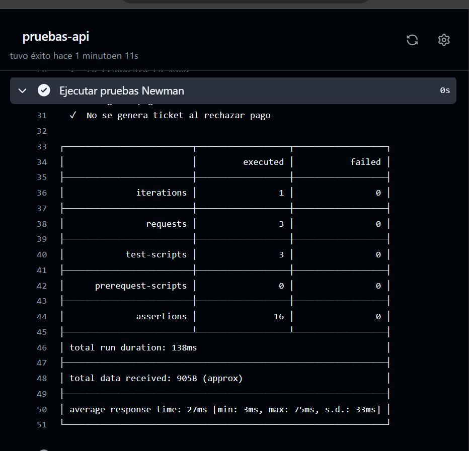
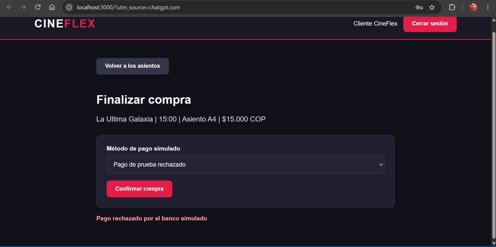
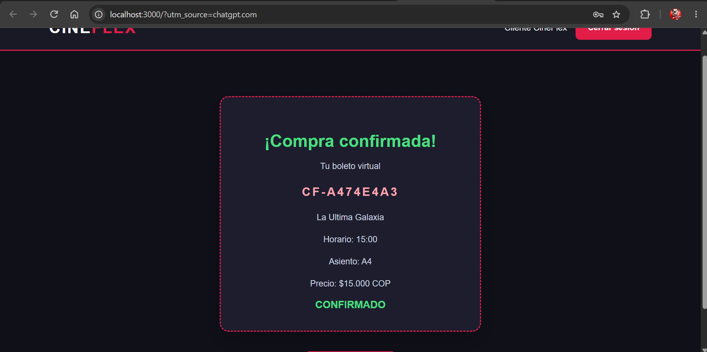

# CineFlex | Taller Práctico Integrador: QA en Producción

**Proyecto:** Aseguramiento de calidad de la plataforma web simulada CineFlex

**Repositorio público:** https://github.com/pollofrito18/qa-cineflex-project

**Equipo:** Luis, Marlon, Esteban y demás integrantes que participen en la entrega.

**Video de sustentación (máximo 3 minutos):** PENDIENTE: sustituir por el enlace público antes de entregar.

> **Para el docente:** CineFlex es una aplicación académica que se ejecuta localmente. GitHub contiene el código fuente, no una página alojada permanentemente en Internet. Siga la sección de instalación para abrirla en su computador.

---

## 1. Inicio rápido para el profesor Kevin

### 1.1. Requisitos previos

Se necesita:

- Windows 10 u 11 y PowerShell.
- Node.js 22 o superior y npm.
- Git.
- Google Chrome u otro navegador moderno.
- Conexión a Internet para descargar las dependencias.

Para comprobar las herramientas instaladas, ejecutar:

```powershell
node --version
npm --version
git --version
```

No es necesario instalar MySQL, MongoDB, Docker, Postman, JMeter ni Visual Studio Code para utilizar la página web. Las herramientas de pruebas se explican más adelante.

### 1.2. Clonar el repositorio

Abrir PowerShell en la carpeta donde se desee descargar el proyecto:

```powershell
git clone https://github.com/pollofrito18/qa-cineflex-project.git
cd qa-cineflex-project\backend
```

Si ya existe una carpeta llamada `qa-cineflex-project`, utilizar otra ubicación.

**Importante:** todos los comandos de instalación siguientes se ejecutan dentro de `backend`.

### 1.3. Instalar las dependencias

```powershell
npm ci
```

Esperar a que termine la instalación. Este comando utiliza el archivo `package-lock.json` incluido en el repositorio.

### 1.4. Configurar JWT automáticamente

CineFlex necesita la variable `JWT_SECRET` para funcionar.

El archivo privado `backend/.env` no se publica en GitHub. Para crearlo automáticamente, ejecutar desde la carpeta `backend`:

```powershell
node -e "const fs=require('node:fs');const crypto=require('node:crypto');if(!fs.existsSync('.env'))fs.writeFileSync('.env','PORT=3000\nJWT_SECRET='+crypto.randomBytes(32).toString('hex')+'\n')"
```

Este comando genera una clave aleatoria y solo crea el archivo si todavía no existe.

Comprobar la configuración:

```powershell
Test-Path .\.env
```

El resultado debe ser:

```text
True
```

### 1.5. Iniciar el Backend y la página

Ejecutar:

```powershell
npm start
```

Mantener abierta esta terminal mientras se utiliza la aplicación.

El servidor inicia normalmente en el puerto `3000`.

Abrir Google Chrome e ingresar a:

**http://localhost:3000/**

No abrir `frontend/index.html` directamente desde el explorador de archivos, ya que la página necesita el Backend para cargar sus recursos y realizar las solicitudes.

### 1.6. Credenciales de demostración

| Dato | Valor |
|---|---|
| Correo electrónico | `cliente@cineflex.com` |
| Contraseña | `CineFlex123!` |
| Dirección local | http://localhost:3000/ |

Estas credenciales pertenecen a una cuenta ficticia creada para evaluar el proyecto académico.

### 1.7. Verificar que el servidor funciona

Abrir en el navegador:

http://localhost:3000/api/health

También se puede ejecutar desde otra terminal:

```powershell
Invoke-RestMethod http://localhost:3000/api/health
```

Respuesta esperada:

```json
{
  "estado": "OK",
  "mensaje": "Servidor CineFlex funcionando correctamente"
}
```

### 1.8. Probar la página

Una vez dentro de CineFlex:

1. Iniciar sesión con las credenciales proporcionadas.
2. Comprobar que aparezcan tres películas en la cartelera.
3. Seleccionar una película.
4. Elegir un horario.
5. Seleccionar un asiento disponible.
6. Presionar **Continuar al pago**.
7. Elegir **Pago de prueba aprobado**.
8. Confirmar la compra.
9. Verificar que aparezca un ticket virtual con película, asiento, horario, código y estado `CONFIRMADO`.
10. Regresar a la cartelera y cerrar sesión.

También existe la opción **Pago de prueba rechazado**, utilizada para comprobar la validación negativa del banco simulado.

No se procesa dinero real.

### 1.9. Cerrar la aplicación

Volver a la terminal donde se está ejecutando `npm start` y presionar `Ctrl + C`.

---

## 2. Introducción

CineFlex es una aplicación web simulada para la reserva y compra de entradas de cine.

El proyecto fue desarrollado para aplicar técnicas de aseguramiento de calidad (QA), automatización de pruebas y evaluación de rendimiento.

Las funcionalidades principales son:

- Inicio de sesión con autenticación JWT.
- Consulta de películas en cartelera.
- Selección de horarios.
- Consulta de asientos disponibles y ocupados.
- Reserva de entradas.
- Simulación de pagos aprobados y rechazados.
- Generación de tickets virtuales.
- Cierre de sesión.
- Bloqueo temporal después de tres intentos fallidos de autenticación.

### Tecnologías utilizadas

| Componente | Tecnología |
|---|---|
| Frontend | HTML, CSS y JavaScript |
| Backend | Node.js y Express |
| Autenticación | JWT y bcryptjs |
| Seguridad HTTP | Helmet |
| Registro de solicitudes | Morgan |
| Pruebas de API | Postman y Newman |
| Pruebas de interfaz | Selenium WebDriver |
| Patrón de automatización | Page Object Model |
| Rendimiento | Apache JMeter |
| Integración continua | GitHub Actions |

### Funcionamiento general

```text
Navegador web
      |
      v
Frontend HTML, CSS y JavaScript
      |
      v
Backend Node.js + Express
      |
      +-- Autenticación JWT
      |
      +-- Cartelera de películas
      |
      +-- Consulta de asientos
      |
      +-- Reservas
             |
             v
       Stub bancario
        /          \
   Aprobado      Rechazado
   HTTP 201      HTTP 402
      |
      v
 Ticket virtual
```

El Backend también sirve los archivos del Frontend, por lo que la aplicación funciona desde una sola dirección: `http://localhost:3000/`.

**Alcance:** CineFlex es un sistema mock. Las reservas se guardan temporalmente en memoria y se restablecen al reiniciar el servidor. No utiliza una base de datos persistente.

---

## 3. Estructura del proyecto

```text
qa-cineflex-project/
├── README.md
├── estrategia_pruebas.pdf
├── .gitignore
│
├── backend/
│   ├── server.js
│   ├── package.json
│   ├── package-lock.json
│   └── .env.example
│
├── frontend/
│   ├── index.html
│   ├── styles.css
│   └── app.js
│
├── api_tests/
│   ├── CineFlex_API_Collection.json
│   └── CineFlex_Environment.json
│
├── ui_tests/
│   ├── pages/
│   │   ├── LoginPage.js
│   │   ├── CarteleraPage.js
│   │   └── ReservaPage.js
│   ├── test_suite.js
│   ├── package.json
│   └── package-lock.json
│
├── performance/
│   └── prueba_carga.jmx
│
├── evidencias/
│   ├── 18_selenium_18_de_18.png
│   └── Evidencias_CineFlex_Recuperadas/
│
└── .github/
    └── workflows/
        └── qa-pipeline.yml
```

El archivo `.env.example` es una plantilla pública de configuración que debe incorporarse al repositorio.

El archivo `.env` contiene la configuración local y no debe publicarse.

---

## 4. Fase A — Arquitectura y estrategia de pruebas

### 4.1. Reto 1: Integración Top-Down y Stub bancario

Se seleccionó la estrategia de integración **Top-Down**, porque permite comprobar primero los componentes principales e integrar progresivamente las funcionalidades dependientes.

Como no se dispone de una pasarela bancaria real para las pruebas, se implementó un Stub bancario.

Este mecanismo simula las respuestas de una entidad financiera.

La implementación se encuentra en `backend/server.js`, dentro de la función `simularPago()`.

| Tarjeta de prueba | Respuesta | Resultado |
|---|---|---|
| `PRUEBA_APROBADA` | HTTP 201 | Reserva confirmada y ticket virtual |
| `TARJETA_FALSA` | HTTP 402 | Pago rechazado |

De esta manera se puede evaluar el proceso de compra sin realizar transacciones reales.

### 4.2. Reto 2: Requisitos y estrategia de regresión

**Requisitos funcionales**

**RF-01: Autenticación**

El sistema debe permitir el inicio de sesión mediante credenciales válidas.

**RF-02: Reservas**

El sistema debe permitir seleccionar una película, un horario y un asiento disponible, confirmar un pago simulado y generar un ticket virtual.

**Requisitos no funcionales**

**RNF-01: Tiempo de respuesta**

Se debe comprobar que la consulta de cartelera responda en menos de 300 milisegundos en el entorno de pruebas.

**RNF-02: Rendimiento**

Se debe ejecutar una prueba de carga con 500 usuarios virtuales y un periodo de inicio gradual de 15 segundos.

**Estrategia de regresión**

Las pruebas de regresión permiten verificar que las modificaciones del software no afecten funcionalidades existentes.

La selección de pruebas depende del impacto de cada cambio.

Por ejemplo, si únicamente se modifica el color de un botón secundario, se deben priorizar las pruebas relacionadas con la apariencia y el funcionamiento de ese elemento.

No es necesario ejecutar nuevamente toda la suite de pagos si el cambio no afecta dicha funcionalidad.

En cambio, una modificación de la autenticación, las reservas o la lógica bancaria requiere repetir las pruebas relacionadas.

### 4.3. Reto 3: Comparación entre Selenium y Cypress

| Criterio | Selenium WebDriver | Cypress |
|---|---|---|
| Objetivo | Automatizar navegadores | Automatizar pruebas web |
| Aplicación en CineFlex | Flujos completos de reservas | Pruebas rápidas de funcionalidades del Frontend |
| Lenguajes | Compatible con diferentes lenguajes | Principalmente JavaScript y TypeScript |
| Ejecución | Control mediante WebDriver | Herramientas integradas de ejecución y depuración |
| Implementación en este proyecto | Sí | No, comparación técnica |

Se seleccionó **Selenium WebDriver**, utilizando el patrón Page Object Model para organizar las pruebas de interfaz.

**Documento complementario:** [estrategia_pruebas.pdf](estrategia_pruebas.pdf).

---

## 5. Fase B — Backend y pruebas de API

### 5.1. Backend Mock

El servidor fue desarrollado utilizando Node.js y Express.

Incluye:

- Helmet para configurar encabezados de seguridad HTTP.
- Morgan para registrar las solicitudes.
- JWT para proteger los endpoints.
- bcryptjs para verificar las contraseñas.
- Un Stub bancario para procesar pagos simulados.

### 5.2. Peticiones principales

| Método | Endpoint | Resultado esperado |
|---|---|---|
| POST | `/api/auth/login` | HTTP 200 y token JWT |
| GET | `/api/cartelera` | HTTP 200 y JSON con películas |
| POST | `/api/reservas` | HTTP 402 cuando se utiliza una tarjeta falsa |

### 5.3. Pruebas de autenticación

En `POST /api/auth/login` se comprueba:

- Código HTTP 200.
- Respuesta JSON.
- Inicio de sesión exitoso.
- Existencia de un token JWT válido en su estructura.
- Correo del usuario autenticado.

El token se guarda automáticamente en una variable del entorno de Postman.

### 5.4. Pruebas de cartelera

En `GET /api/cartelera` se comprueba:

- Respuesta HTTP 200.
- Formato JSON.
- Existencia de películas.
- Cantidad de películas.
- Información básica de cada película.
- Tiempo de respuesta inferior a 300 milisegundos.

### 5.5. Pruebas de pago rechazado

En `POST /api/reservas` se utiliza `TARJETA_FALSA` para comprobar que:

- La transacción sea rechazada.
- El servidor responda con HTTP 402.
- El mensaje sea correcto.
- No se genere un ticket por el pago rechazado.

### 5.6. Ejecutar Postman

1. Encender el Backend mediante `npm start`.
2. Abrir Postman.
3. Importar `api_tests/CineFlex_API_Collection.json`.
4. Importar `api_tests/CineFlex_Environment.json`.
5. Seleccionar el entorno **CineFlex Local**.
6. Ejecutar las tres solicitudes en este orden: Login, Cartelera y Reserva rechazada.
7. Comprobar el resultado del Collection Runner.

### Resultados registrados

| Métrica | Resultado |
|---|---|
| Peticiones | 3 |
| Aserciones | 16 |
| Aprobadas | 16 |
| Fallidas | 0 |



La colección original incluye tres solicitudes. El pago aprobado puede demostrarse por separado, pero no forma parte de estas 16 aserciones.

---

## 6. Automatización de API mediante Newman

Newman permite ejecutar desde la terminal las pruebas creadas con Postman.

Con el Backend encendido, abrir otra terminal desde la raíz del proyecto:

```powershell
cd backend
npx newman run ..\api_tests\CineFlex_API_Collection.json -e ..\api_tests\CineFlex_Environment.json
```

### Resultados de referencia

- Solicitudes ejecutadas: 3.
- Aserciones aprobadas: 16.
- Aserciones fallidas: 0.

El cumplimiento del tiempo de respuesta inferior a 300 milisegundos debe comprobarse nuevamente en cada entorno, porque depende de las condiciones del equipo.

---

## 7. Fase C — Selenium y Page Object Model

Se implementaron pruebas de interfaz con Selenium WebDriver, ejecutadas mediante Google Chrome.

### 7.1. Organización de Page Object Model

**`LoginPage.js`**

Contiene los localizadores y acciones relacionadas con el inicio y cierre de sesión.

**`CarteleraPage.js`**

Gestiona las acciones relacionadas con las películas y la cartelera.

**`ReservaPage.js`**

Gestiona la selección de horarios, asientos, pagos y tickets.

**`test_suite.js`**

Contiene los casos de prueba y sus aserciones.

Esta organización separa las interacciones de la interfaz de las verificaciones automatizadas.

### 7.2. Casos de prueba

| N.º | Prueba |
|---|---|
| 1 | Inicio de sesión correcto |
| 2 | Cartelera con tres películas |
| 3 | Verificación de títulos |
| 4 | Selección de película |
| 5 | Regreso a la cartelera |
| 6 | Horarios de película 1 |
| 7 | Horarios de película 2 |
| 8 | Verificación de doce asientos |
| 9 | Restricción de asiento ocupado |
| 10 | Restricción al continuar sin asiento |
| 11 | Actualización del asiento seleccionado |
| 12 | Resumen correcto del pago |
| 13 | Pago rechazado |
| 14 | Pago aprobado y ticket |
| 15 | Cambio de horario |
| 16 | Título Cartelera en el DOM |
| 17 | Cierre de sesión y navegación con Atrás |
| 18 | Bloqueo después de tres intentos fallidos |

### 7.3. Ejecutar Selenium

Requisitos:

- Backend encendido.
- Google Chrome instalado.
- Dependencias de Selenium instaladas.

Desde la raíz del proyecto, abrir otra terminal:

```powershell
cd ui_tests
npm ci
npm test
```

### 7.4. Resultados registrados

| Métrica | Resultado |
|---|---|
| Pruebas ejecutadas | 18 |
| Pruebas aprobadas | 18 |
| Pruebas fallidas | 0 |
| Duración aproximada | 42,46 segundos |



La última prueba bloquea temporalmente la cuenta de demostración durante 60 segundos.

Si se desea repetir inmediatamente la suite, se recomienda reiniciar el Backend para restablecer el estado de prueba.

---

## 8. Fase D — Rendimiento con Apache JMeter

Se utilizó Apache JMeter para evaluar el comportamiento de CineFlex ante consultas simultáneas de usuarios virtuales.

El archivo de configuración se encuentra en:

`performance/prueba_carga.jmx`

### 8.1. Configuración

| Parámetro | Valor |
|---|---|
| Usuarios virtuales | 500 |
| Ramp-up | 15 segundos |
| Iteraciones | 1 |
| Método HTTP | GET |
| Endpoint | `/api/peliculas/1/asientos` |
| Autenticación | JWT |

El plan realiza primero una autenticación para obtener un JWT, que se utiliza posteriormente en las consultas de asientos.

### 8.2. Resultados obtenidos

| Métrica | Resultado |
|---|---|
| Solicitudes de autenticación | 1 |
| Consultas de asientos | 500 |
| Total de solicitudes | 501 |
| Porcentaje de errores | 0 % |
| Tiempo promedio aproximado | 3 ms |
| Throughput de consultas | Aproximadamente 33,4 solicitudes por segundo |

Se comprobaron 500 consultas de asientos con cero por ciento de errores durante la prueba local.

Estos resultados no garantizan el mismo comportamiento en todos los equipos o en un entorno real de producción.

### 8.3. Evidencia



### 8.4. Repetir la prueba

Se requiere Java y Apache JMeter.

Con el Backend encendido, ejecutar desde la raíz del proyecto:

```powershell
jmeter -n -t performance/prueba_carga.jmx -l performance/resultados_carga.jtl
```

Si `jmeter` no se reconoce, debe utilizarse la ruta completa de `jmeter.bat`.

Antes de repetir la prueba se debe eliminar o cambiar el nombre de un archivo JTL anterior para evitar mezclar resultados.

---

## 9. GitHub Actions — Integración continua

Se implementó un pipeline mediante GitHub Actions.

Archivo:

`.github/workflows/qa-pipeline.yml`

El pipeline se ejecuta al realizar `push` o `pull_request` hacia la rama `main`.

### Etapas del pipeline

1. Descargar el repositorio.
2. Preparar Node.js 22.
3. Instalar dependencias del Backend mediante `npm ci`.
4. Iniciar el servidor con variables de entorno temporales.
5. Verificar el endpoint de salud.
6. Ejecutar la colección Postman mediante Newman.
7. Marcar como fallida la ejecución si alguna prueba falla.

### Resultados

En las ejecuciones registradas, el pipeline completó correctamente las pruebas de API.

- Peticiones: 3.
- Aserciones: 16.
- Fallidas: 0.

[Consultar GitHub Actions](https://github.com/pollofrito18/qa-cineflex-project/actions)



**Nota:** GitHub Actions ejecuta Newman. Las pruebas de Selenium y JMeter se comprobaron por separado.

---

## 10. Evidencias del proyecto

Los archivos de evidencia se encuentran dentro del directorio `evidencias`.

### Documento de estrategia

[Consultar estrategia de pruebas](estrategia_pruebas.pdf)

### Colección de Postman

[Consultar colección de API](api_tests/CineFlex_API_Collection.json)

### Entorno de Postman

[Consultar variables de entorno](api_tests/CineFlex_Environment.json)

### Pago rechazado



### Ticket virtual



### Selenium


### JMeter


### GitHub Actions


---

## 11. Solución de errores frecuentes

| Problema | Solución |
|---|---|
| `git` no se reconoce | Instalar Git y abrir otra terminal |
| `node` o `npm` no se reconoce | Instalar Node.js 22 o superior |
| `ENOENT package.json` | Ejecutar los comandos de inicio dentro de `backend` |
| `Falta JWT_SECRET` | Crear `.env` siguiendo el paso 1.4 |
| `EADDRINUSE` | Liberar el puerto 3000 |
| La página no tiene estilos | Abrir `http://localhost:3000/` con el Backend encendido |
| Error HTTP 401 | Revisar las credenciales |
| Error HTTP 423 | Esperar el desbloqueo temporal de 60 segundos |
| Error HTTP 409 | Seleccionar otro asiento disponible |
| Error HTTP 402 | Es el rechazo esperado del pago de prueba |
| Token inválido | Iniciar sesión nuevamente |
| Fallo en `npm ci` | Verificar conexión a Internet y la instalación de Node.js |
| Selenium no inicia | Comprobar Chrome y el Backend |

### Comprobación de instalación limpia

Antes de evaluar el proyecto en otro computador, se recomienda:

1. Clonar el repositorio en una carpeta nueva.
2. Instalar las dependencias mediante `npm ci`.
3. Generar el archivo `.env`.
4. Iniciar con `npm start`.
5. Comprobar `/api/health`.
6. Abrir la página.
7. Iniciar sesión.
8. Completar una reserva simulada.

Esto permite verificar que la aplicación funciona sin depender de archivos privados o dependencias instaladas previamente.

---

## 12. Seguridad y limitaciones

CineFlex fue desarrollado con fines académicos.

Por esta razón:

- No procesa pagos reales.
- No utiliza tarjetas bancarias verdaderas.
- Las credenciales son ficticias.
- Las reservas se guardan temporalmente en memoria.
- No dispone de una base de datos relacional persistente.
- El archivo `.env` no se publica en GitHub.
- La clave JWT se genera individualmente en cada instalación.
- GitHub Actions ejecuta las pruebas de API, pero no publica la página en Internet.
- Las pruebas exitosas no garantizan ausencia de vulnerabilidades.

La aplicación requiere adaptaciones adicionales antes de un despliegue real en producción.

---

## 13. Video de sustentación

**Duración máxima:** 3 minutos.

**Enlace público:** PENDIENTE DE AGREGAR ANTES DE LA ENTREGA.

La sustentación debe mostrar:

- Funcionamiento de la página web.
- Arquitectura de CineFlex.
- Estrategia Top-Down.
- Código del Stub bancario.
- Requisitos y estrategia de regresión.
- Comparación de Selenium y Cypress.
- Patrón Page Object Model.
- Pruebas automatizadas.
- Resultados de JMeter.
- Pipeline de GitHub Actions.

Distribución orientativa:

| Participante | Tema |
|---|---|
| Luis | Página, arquitectura, requisitos y Selenium |
| Marlon | Top-Down y Stub bancario |
| Esteban | Pruebas de API con Postman |
| Cuarto integrante, si participa | JMeter y GitHub Actions |

Todos los participantes deben explicar su parte y mostrar su participación, de acuerdo con las indicaciones del profesor.

---

## 14. Conclusiones

El desarrollo de CineFlex permitió implementar un sistema web simulado y aplicar diferentes técnicas de aseguramiento de calidad.

Postman y Newman permitieron comprobar los endpoints principales mediante 16 aserciones automatizadas.

Selenium WebDriver permitió verificar 18 escenarios de interfaz utilizando el patrón Page Object Model.

Apache JMeter permitió evaluar un escenario de 500 usuarios virtuales, obteniendo cero por ciento de errores durante la ejecución local.

Finalmente, GitHub Actions automatizó las pruebas de API después de los cambios en el repositorio.

Los resultados obtenidos demuestran el funcionamiento de los escenarios evaluados y la importancia de las pruebas automatizadas durante el desarrollo de software.

---

**Proyecto académico CineFlex — QA en Producción**

**Repositorio:** https://github.com/pollofrito18/qa-cineflex-project